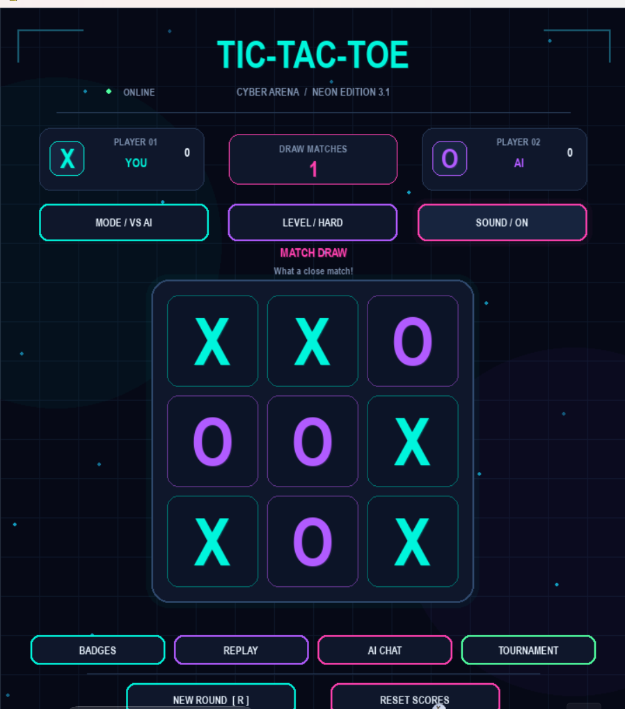

# 🎮 Neon Cyberpunk Tic-Tac-Toe

<p align="center">
  <strong>A Futuristic Tic-Tac-Toe Gaming Experience</strong>
  <br>
  Built with Python and Pygame, featuring intelligent AI, neon visuals, achievements, replay system, and tournaments.
</p>

<p align="center">
  
  
  
  
</p>

---

## 🚀 About The Project

Neon Cyberpunk Tic-Tac-Toe is a modern desktop game developed using Python and Pygame.

It transforms the classic Tic-Tac-Toe experience into a futuristic gaming environment with neon-inspired visuals, intelligent AI opponents, sound effects, achievements, and tournament gameplay.

## ✨ Features

- 🤖 **Smart AI Opponent:** Easy, Medium, and Hard difficulty levels.
- 🧠 **Minimax Algorithm:** Hard mode uses Minimax for optimal AI decisions.
- 👥 **Two Player Mode:** Play with a friend.
- 🏆 **Achievement System:** Unlock achievements through gameplay.
- 🔄 **Replay System:** Review previous matches and moves.
- ⚔️ **Tournament Mode:** Play Best of 3 and Best of 5.
- 📊 **Statistics:** Track wins and match history.
- 🔊 **Sound Effects:** Interactive game audio.
- 💾 **Persistent Data:** Save player statistics locally.
- 🌌 **Cyberpunk UI:** Futuristic neon-inspired interface.

---

## 🖥️ Game Preview

<p align="center">
  
</p>

<p align="center">
  <em>Neon Cyberpunk Tic-Tac-Toe — Version 3.1</em>
</p>

---

## 🛠️ Technologies Used

| Technology | Purpose |
|---|---|
| Python | Core programming |
| Pygame | Game development and UI |
| Minimax Algorithm | AI decision-making |
| JSON | Local data storage |
| Git & GitHub | Version control |

## 📂 Project Structure

```text
Neon-Cyberpunk-TicTacToe/
│
├── screenshots/
│   └── gameplay.png
│
├── tests/
│   └── test_game.py
│
├── main.py
├── game.py
├── ui.py
├── audio.py
├── requirements.txt
├── README.md
└── .gitignore
```

## ⚙️ Installation & Setup

### 1. Clone the repository

```bash
git clone https://github.com/Rajukumar1202/Neon-Cyberpunk-TicTacToe.git
```

### 2. Open the project folder

```bash
cd Neon-Cyberpunk-TicTacToe
```

### 3. Create a virtual environment

```bash
python -m venv .venv
```

### 4. Activate the environment

**Windows:**

```bash
.venv\Scripts\activate
```

### 5. Install dependencies

```bash
pip install -r requirements.txt
```

### 6. Run the game

```bash
python main.py
```

---

## 🎯 AI Difficulty Levels

| Level | Description |
|---|---|
| Easy | Beginner-friendly opponent |
| Medium | Moderate challenge |
| Hard | Minimax-based optimal opponent |

## 🏆 Achievement System

Unlock achievements as you play, improve, and win matches.

## 🔮 Future Improvements

- Online multiplayer mode
- More AI personalities
- Advanced game themes
- Global leaderboard
- Improved animations and effects

---

## 👨‍💻 Developer

**Raju Kumar**

B.Tech Computer Science & Engineering | AI/ML Enthusiast

- GitHub: [@Rajukumar1202](https://github.com/Rajukumar1202)

---

<p align="center">
  ⭐ If you like this project, consider giving it a star!
  <br>
  Built with ❤️ using Python and Pygame.
</p>
